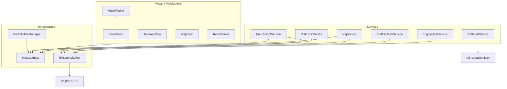

# `desktop/` — C# WPF client and Excel integration

All **user-facing** behavior: windows, menus, blotter, treemap, NLQ bar, file dialogs, risk limits, engine process management, and Excel RTD. Numerics stay in [`engine/`](../engine/README.md).

## Solution layout

| Project | README | Role |
|---------|--------|------|
| **Riskbot.App** | [Riskbot.App/README.md](Riskbot.App/README.md) | Main WPF executable |
| **Riskbot.Rtd** | [Riskbot.Rtd/README.md](Riskbot.Rtd/README.md) | Excel-DNA RTD COM add-in |
| **Riskbot.RtdBridge** | [Riskbot.RtdBridge/README.md](Riskbot.RtdBridge/README.md) | Snapshot file contract (shared by App + Rtd) |
| **Riskbot.App.Tests** | [Riskbot.App.Tests/README.md](Riskbot.App.Tests/README.md) | xUnit tests |

Build: `desktop/Riskbot.sln` · Run: see [../RUN.md](../RUN.md).

## Why C# / .NET for the desktop?

| Requirement | C# advantage |
|-------------|--------------|
| Native Windows UI | WPF data binding, attached behaviors (cell flash), high-DPI |
| Excel `.xlsx` without Excel installed | **Open XML SDK** in `ExcelIntegration/` |
| Live Excel cells | **Excel-DNA** COM RTD in `Riskbot.Rtd` |
| Child process management | `EngineHostService` spawns Python cleanly |
| Responsive UI + background work | `async/await`, `System.Threading.Channels` message bus |

**vs Python (PyQt/wx):** Weaker COM/RTD story, GIL contention with heavy UI updates, no first-class Excel Open XML ergonomics.

**vs Electron:** Large runtime, poor COM RTD, awkward local process orchestration.

**vs JavaFX:** Smaller Windows/Office integration ecosystem.

## Architecture (App)

## Composition root

[`Riskbot.App/App.xaml.cs`](Riskbot.App/App.xaml.cs) registers DI (`Microsoft.Extensions.DependencyInjection`): bus, API client (`HttpClient` → `127.0.0.1:8765`), workspace, enrichment, NLQ, risk monitors, view models.

## Contract alignment

| Desktop | Shared / engine |
|---------|-----------------|
| `ApiClient/ContractModels.cs` | `shared/openapi.yaml` |
| `ApiClient/RiskbotApiClient.cs` | All HTTP endpoints |
| `ExcelIntegration/PortfolioFileManager.cs` | `shared/portfolio_schema.json` |
| `Helpers/RiskLimitsMapper.cs` | `RiskLimits` in OpenAPI |

## Engine lifecycle

[`EngineHostService.cs`](Riskbot.App/Services/EngineHostService.cs):

1. Probe `GET /health`
2. If down, spawn `python -m uvicorn main:app` with cwd = `engine/`
3. Poll up to ~30s; surface status on main window

Repo discovery: [`Infrastructure/RepoPaths.cs`](Riskbot.App/Infrastructure/RepoPaths.cs).

## Message bus (decoupling UI)

[`Bus/MessageBus.cs`](Riskbot.App/Bus/MessageBus.cs) — channel-based pub/sub. Key events:

| Event | Typical subscribers |
|-------|---------------------|
| `PortfolioLoadedEvent` | `EnrichmentService` |
| `EnrichmentCompleteEvent` | `BlotterViewModel`, treemap |
| `PositionUpdatedEvent` | `RiskLimitMonitor` |
| `RiskBreachesUpdatedEvent` | Blotter amber borders |
| `NlqResultEvent` | `ResultViewModel` |

**Why bus in C# not Python?** UI reactivity and breach styling are client concerns; engine remains stateless request/response.

## Major menus → code

| Menu action | Entry point |
|-------------|-------------|
| File → Open Portfolio | `PortfolioWorkspaceService` → `PortfolioFileManager` |
| View → Refresh Market Data | `EnrichmentService.RefreshAsync` |
| Risk → Run Full Risk Report | `RiskAnalysisService` |
| Risk → ESG & Exclusion Preferences | `EsgPreferencesService` |
| Help → API Key Settings | `EnvFileStore` → repo `.env` |

Parent: [../README.md](../README.md)
