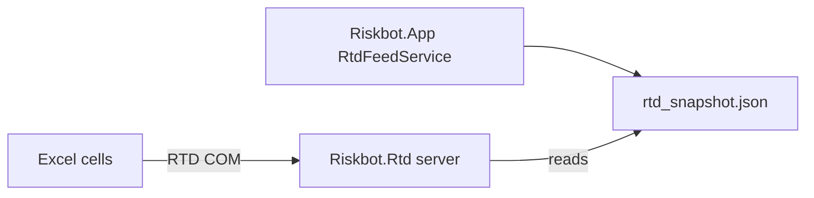

# `Riskbot.Rtd` — Excel real-time data (RTD) add-in

**Excel-DNA** COM server exposing live portfolio fields to any open workbook:

```excel
=RTD("Riskbot.RTD",,"AAPL","CurrentPrice")
```

## Why C# (and COM) here?

Excel RTD is a **Windows COM contract**. Excel-DNA is the pragmatic .NET bridge; Python cannot register as an in-process Excel RTD server without a separate COM shim.

| Approach | Fit |
|----------|-----|
| C# + Excel-DNA | Supported, documented RTD pattern |
| Python xlwings RTD | Extra daemon, fragile on corporate desktops |
| VBA | No shared logic with WPF app |

## Key files

| File | Role |
|------|------|
| [`RiskbotRtdServer.cs`](RiskbotRtdServer.cs) | `ExcelRtdServer` — topic connect, 1s poll timer |
| [`RiskbotAddIn.cs`](RiskbotAddIn.cs) | Excel-DNA registration |

## Data path (no HTTP from Excel)



[`RtdFeedService`](../Riskbot.App/Services/RtdFeedService.cs) in the desktop app writes the snapshot when the portfolio is enriched/updated. The add-in **only reads** the file—Excel never talks to Python directly.

## Bridge library

Validation and field names live in [`Riskbot.RtdBridge`](../Riskbot.RtdBridge/README.md) so App and Rtd do not duplicate string literals.

## Build and install

```powershell
cd desktop
dotnet build Riskbot.Rtd\Riskbot.Rtd.csproj
```

Outputs in `Riskbot.Rtd\bin\Debug\net8.0-windows\`: `Riskbot.Rtd.xll` / `Riskbot.Rtd64.xll`, `Riskbot.Rtd.dna`, `Riskbot.Rtd.dll`.

**Install in Excel:** File → Options → Add-ins → Excel Add-ins → Browse → select `Riskbot.Rtd.xll` (or the 64-bit variant for 64-bit Excel). On first load the add-in registers ProgId **`Riskbot.RTD`**.

## Manual test

1. Run Riskbot, open a portfolio, wait for enrichment.
2. Load the RTD add-in in Excel.
3. In a cell: `=RTD("Riskbot.RTD",,"AAPL","CurrentPrice")` (use a ticker in your book).
4. Refresh market data in Riskbot — Excel cells update within about a second.

**Help → Excel RTD Formulas…** in the app lists all field names and copies example formulas.

## Fields

| Field | Source |
|-------|--------|
| `CurrentPrice` | Enrichment |
| `MarketValue`, `PnL`, `PnLPct`, `WeightPct` | Blotter math |
| `Beta`, `EsgScore`, `CarbonIntensity` | Enrichment |
| `Delta` | `POST /risk/greeks` after enrich |
| `VarContributionPct` | VaR load event |

## Security

Topic validation: [`RtdTopicValidator`](../Riskbot.RtdBridge/RtdTopicValidator.cs). Tests: [`Riskbot.App.Tests/RtdSecurityTests.cs`](../Riskbot.App.Tests/RtdSecurityTests.cs).

| Control | Purpose |
|---------|---------|
| Snapshot path under `%LocalAppData%\Riskbot` only | Blocks path traversal |
| Max snapshot size (5 MB) and topic count (50k) | Limits deserialization / memory abuse |
| Field allowlist (`RtdFields`) | Excel cannot subscribe to arbitrary snapshot keys |
| Ticker charset and length caps | Blocks path-like or huge topic strings |
| Max Excel subscriptions (10k) | Caps the add-in's in-memory topic list |
| Atomic write (temp + replace) | Readers never see half-written JSON |

**Trust boundary:** any process running as the same user can overwrite `rtd_snapshot.json`, and Excel will show those values. That is acceptable for a local desktop bridge, not for a multi-user or network API.

Parent: [../README.md](../README.md)
