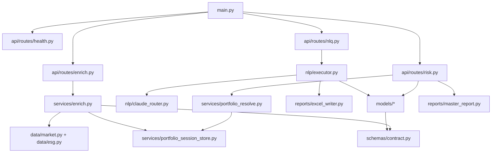

# `engine/` — Python quantitative risk server

The **Riskbot engine** is a FastAPI application served by Uvicorn on `127.0.0.1:8765`. It owns every calculation, external data fetch, NLQ route, and Excel report write. The WPF app is a thin client except for UI, file I/O, and limit monitoring.

## Why Python for the engine?

| Need | Python advantage vs typical alternatives |
|------|------------------------------------------|
| VaR / GARCH / optimization | `numpy`, `scipy`, `arch` — standard quant stack |
| Market + ESG data | `yfinance`, HTTP clients, quick scripting in `data/` |
| NLQ + Claude | Official `anthropic` SDK, rapid prompt iteration in `nlp/` |
| Chart + Excel reports | `matplotlib` + `openpyxl` in one process |
| Fast iteration | REPL-friendly model tweaks without WPF rebuild |

**vs C# for numerics:** Fine for UI and Excel, but fewer free libraries for GARCH order selection, distribution fitting, and ad-hoc research. Duplicating models in C# would split test and formula truth.

**vs R:** Strong stats, weaker as a long-running HTTP service and harder to embed in a desktop-spawned child process on Windows.

**vs Rust/C++:** Production HFT-grade latency is unnecessary here; development velocity and library breadth matter more.

## Entry point and layout

```
engine/
├── main.py                 # FastAPI app, .env load, router mount
├── requirements.txt
├── api/routes/             # HTTP handlers → services/models
├── schemas/                # Pydantic ↔ shared/openapi.yaml
├── services/               # Enrich pipeline, session store
├── data/                   # yfinance, ESG, disk cache
├── models/                 # VaR, Greeks, GARCH, stress, sustainability
├── nlp/                    # Claude router + NLQ executor
├── reports/                # Excel workbooks + matplotlib charts
├── tests/                  # pytest
└── output/reports/         # Generated .xlsx (gitignored in normal use)
```

Start manually:

```powershell
cd engine
python -m uvicorn main:app --host 127.0.0.1 --port 8765
```

Or let [`desktop/Riskbot.App/Services/EngineHostService.cs`](../desktop/Riskbot.App/Services/EngineHostService.cs) spawn the same command.

## Request lifecycle

1. **Enrich** — Desktop sends raw positions → `services/enrich.py` pulls prices, returns, vol, ESG, carbon → `portfolio_session_store` retains full `returns_252d` for models.
2. **Risk / NLQ** — Client sends `portfolio_session_id` (or inline portfolio for tests) → `services/portfolio_resolve.py` loads session → model runs → JSON (+ optional report path).
3. **Reports** — `reports/excel_writer.py` writes under `engine/output/reports/`; desktop opens path after validation.

## Subfolder documentation

| Folder | README |
|--------|--------|
| `api/` | [api/README.md](api/README.md) |
| `models/` | [models/README.md](models/README.md) |
| `nlp/` | [nlp/README.md](nlp/README.md) |
| `reports/` | [reports/README.md](reports/README.md) |
| `data/` | [data/README.md](data/README.md) |
| `services/` | [services/README.md](services/README.md) |
| `schemas/` | [schemas/README.md](schemas/README.md) |
| `tests/` | [tests/README.md](tests/README.md) |

## Critical file graph



## Links to `shared/` and `desktop/`

| Engine file | Partner |
|-------------|---------|
| `schemas/contract.py` | `shared/openapi.yaml` |
| `models/stress.py` | `shared/scenarios.json` |
| `main.py` (`.env`) | Repo root `.env`, loaded also by desktop `EnvFileLoader` |
| Session TTL (4h) | Matches enrich cache TTL in `data/cache.py` |

| Desktop caller | Engine endpoint |
|----------------|-----------------|
| `EnrichmentService` | `POST /enrich` |
| `NlqService` | `POST /nlq` |
| `PortfolioRiskService` | `POST /risk/var`, `/risk/garch`, … |
| `RiskAnalysisService` | `POST /risk/full-report` |

## Tests

```powershell
cd engine
python -m pytest -q
```

See [tests/README.md](tests/README.md).

## Environment

| Variable | Effect |
|----------|--------|
| `ANTHROPIC_API_KEY` | Enables Claude NLQ routing in `nlp/claude_router.py` |
| (repo `.env`) | Loaded by `main.py` via `python-dotenv` |

Parent doc: [../README.md](../README.md) · Runbook: [../RUN.md](../RUN.md)

## MCP server (Claude Desktop / Claude Code)

`mcp_server.py` exposes read-only risk calculations over the Model Context Protocol, each
returning the result plus a step-by-step math trace (formulas in LaTeX, substituted numbers,
assumptions, an input hash for reproducibility).

| Tool | Purpose |
| --- | --- |
| `var_trace` | Parametric VaR and expected shortfall, every step shown |
| `stress_trace` | Named or custom stress scenario, with the shock lookup per position |
| `list_stress_scenarios` | Available scenarios and their shocks |

It also serves the model documentation as the resource `riskbot://docs/models`.

Run locally over stdio (data stays on your machine):

```bash
cd engine && pip install -r requirements.txt && python mcp_server.py
```

Claude Desktop (`claude_desktop_config.json`):

```json
{ "mcpServers": { "riskbot": { "command": "python", "args": ["/path/to/Arink/engine/mcp_server.py"] } } }
```

Claude Code: `claude mcp add riskbot -- python /path/to/Arink/engine/mcp_server.py`

Notes: portfolios must already contain daily returns (`returns_252d`); the server never calls
the network or writes files. A shared, remote deployment would additionally need authentication,
TLS, access control and audit logging, and is out of scope here.
