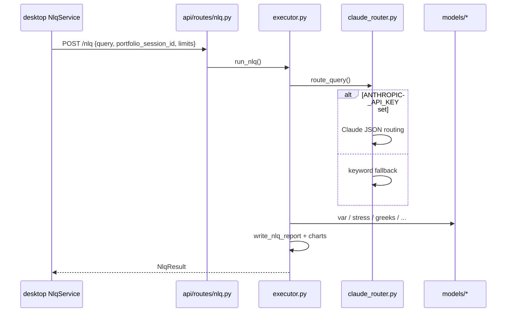

# `engine/nlp/` — natural language query (NLQ)

Turns a **plain-English question** plus an enriched portfolio into routed model runs, a formatted answer, and an Excel report. This is the product differentiator (Step 6).

## Modules

| File | Role |
|------|------|
| [`claude_router.py`](claude_router.py) | Maps query → `RoutingInstruction` (models, parameters, explanation ask) |
| [`executor.py`](executor.py) | Runs models, builds `NlqResult`, calls report writer |
| [`prompts.py`](prompts.py) | System prompt constraining Claude to JSON routing |
| [`anthropic_config.py`](anthropic_config.py) | Model name from env |

## Flow

## Why Python for NLQ?

- **Claude SDK** and prompt files colocated with **model execution** — one process, no round-trip to C# per model.
- **Keyword fallback** in the same module set for CI and offline dev without API keys.

**vs routing in C#:** Would require HTTP callbacks into Python for every model anyway, or duplicating quant in two languages.

**vs LLM-only answers without executor:** Non-reproducible; this design forces routed calls to deterministic `models/*` code.

## Allowed models (router whitelist)

`var`, `concentration`, `sustainability`, `greeks`, `stress`, `garch` — see `ALLOWED_NLQ_MODELS` in `claude_router.py`. Executor enforces the same set.

## Desktop links

| C# | Python |
|----|--------|
| [`NlqService.cs`](../../desktop/Riskbot.App/Services/NlqService.cs) | `POST /nlq` |
| [`NlqViewModel.cs`](../../desktop/Riskbot.App/ViewModels/NlqViewModel.cs) | Binds result panel |
| [`ResultViewModel.cs`](../../desktop/Riskbot.App/ViewModels/ResultViewModel.cs) | Topline, formula, "Open Excel Report" |
| [`NlqErrorSanitizer.cs`](../../desktop/Riskbot.App/Helpers/NlqErrorSanitizer.cs) | Strips paths/keys from errors |

Bus events: `NlqStartedEvent`, `NlqResultEvent`, `NlqFailedEvent`, `NlqCancelledEvent`.

## Configuration

`ANTHROPIC_API_KEY` in repo [`.env`](../../.env) — written by desktop **Help → API Key Settings** (`EnvFileStore`), engine reload on restart.

Parent: [../README.md](../README.md)
