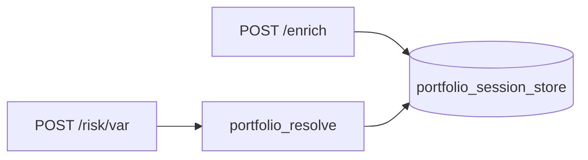

# `engine/services/` — orchestration and session state

Coordinates **multi-step engine workflows** between HTTP routes and `data/` / `models/`.

## Modules

| File | Role |
|------|------|
| [`enrich.py`](enrich.py) | Build `EnrichedPortfolio`, create session id, slim response for display |
| [`portfolio_session_store.py`](portfolio_session_store.py) | In-memory `portfolio_session_id` → full portfolio (4h TTL) |
| [`portfolio_resolve.py`](portfolio_resolve.py) | Resolve session id or inline portfolio on risk/NLQ requests |

## Session model (critical cross-folder concept)

After enrich:

1. Engine stores **full** `EnrichedPortfolio` (including `returns_252d`, options chains).
2. Client stores `portfolio_session_id` in [`PortfolioSessionState`](../../desktop/Riskbot.App/Services/PortfolioSessionState.cs).
3. Subsequent `POST /risk/*` and `POST /nlq` send only the id—avoiding multi-megabyte JSON on every VaR click.

## Why not put this in `api/routes`?

Routes stay thin; session TTL and purge logic are **reused** by enrich, risk, and NLQ. Testable without HTTP via direct imports.

## Desktop alignment

| Engine | Desktop |
|--------|---------|
| `portfolio_session_id` | `PortfolioSessionState.PortfolioSessionId` |
| Enrich generation / stale guard | `PortfolioSessionState.BeginEnrich()` + `enrichGeneration` on NLQ |

Parent: [../README.md](../README.md)
