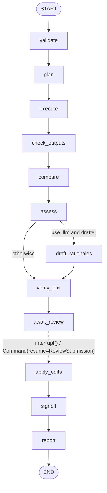

# riskbot.orchestration

`RunService` (contract `ports.RunService`) implemented as a LangGraph state machine with a SQLite
checkpointer and a human-in-the-loop review interrupt.

```python
from riskbot.orchestration import run_service, ScriptedDrafter

svc = run_service(registry=..., planner=..., executor=..., comparator=..., verifier=..., store=...,
                  reporter=..., assessor=..., samples={QuestionId.Q1: market.sample_dataset, ...},
                  drafter=None, checkpoint_path="runs.ckpt.sqlite")
rec = svc.start_run(RunRequest(question=QuestionId.Q1, dataset=ds), wait=True)   # -> awaiting_review
svc.submit_review(rec.run_id, ReviewSubmission(decision="approve", reviewer="ana"))
report = svc.get_report(rec.run_id)
```

The package imports only `riskbot.contract`, the standard library and `langgraph`. All neighbours arrive
as arguments typed with the contract Protocols; the tests use `contract.fakes` exclusively.

| Module | Contents |
|---|---|
| `__init__.py` | `run_service(...)` factory, re-exports `ScriptedDrafter`, `RunState`, `OrchestratedRunService` |
| `service.py` | `OrchestratedRunService`: the facade, synchronous validation, status/audit rules, threading |
| `graph.py` | `RunState` schema, `RunNodes` (node implementations), `build_graph` |
| `validation.py` | dataset-kind, `catalog.LIMITS` and plan checks shared by `start_run`, `calc`, `validate` |
| `drafting.py` | `ScriptedDrafter`, an offline `RationaleDrafter` for tests and demos |

## Graph



One graph is compiled per service with `SqliteSaver(sqlite3.connect(checkpoint_path, check_same_thread=False))`;
each run is a LangGraph thread with `thread_id = run_id`. Every invocation uses `durability="sync"`, so
the checkpoint is on disk before `invoke` returns.

## State schema (`graph.RunState`)

The state is **plain JSON** (`model_dump(mode="json")`), so the default checkpoint serializer stores it and
another process can resume it. The request (with the possibly large dataset) is *not* copied into the state:
nodes read it from the `RunStore` by `run_id`. Published artefacts (record, result, sign-off, audit log)
live in the `RunStore`; the checkpoint holds only what the graph needs to continue.

| Key | Type (JSON of) | Written by |
|---|---|---|
| `run_id` | `str` | `start_run` (initial input) |
| `use_llm` | `bool` | `start_run` |
| `plan` | `QuestionPlan` (resolved: request plan or catalogue default) | `start_run` |
| `specs` | `list[VariationSpec]` | `plan` |
| `variations` | `list[VariationResult]`, same order as `specs` | `execute` |
| `output_findings` | `list[VerifierFinding]` | `check_outputs` |
| `comparison` | `Comparison` | `compare` |
| `assessment` | `QualitativeAssessment` | `assess`, `verify_text`, `apply_edits` |
| `drafts` | `dict[factor_id, str]` | `assess` (empty), `draft_rationales` |
| `verifier_findings` | `list[VerifierFinding]` (outputs + drafts) | `verify_text` |
| `review` | `ReviewSubmission` | `await_review` (resume value) |
| `signoff` | `SignOff` | `signoff` |

## Node contracts

| Node | Reads | Does | Fails the run when |
|---|---|---|---|
| `validate` | request (store) | re-checks dataset kind and limits; `pending -> running` | dataset invalid (defensive; `start_run` already checked) |
| `plan` | `plan` | `planner.expand(plan, seed)` (deterministic, same as in `start_run`) | planner raises |
| `execute` | `specs`, dataset | `executor.execute` on a `ThreadPoolExecutor(min(4, cpu))`, order preserved; an executor that raises is captured as a `VariationResult.error`; audits `variations_failed` if any failed | **zero grid variations succeeded** |
| `check_outputs` | `variations` | `verifier.check_outputs` -> `output_findings` | verifier raises |
| `compare` | `plan`, `variations` | `comparator.compare` | comparator raises |
| `assess` | dataset, `variations`, `comparison` | `assessor.assess` (rule pre-fill) | assessor raises |
| `draft_rationales` | `assessment`, `variations` | `drafter.draft`; a drafter exception is audited (`llm_draft_failed`) and ignored | never |
| `verify_text` | `drafts` | `verifier.verify_text("factor:<id>/rationale", ...)` per draft. Any unmatched number rejects that draft (rule rationale kept, findings kept, `llm_draft_rejected`); accepted drafts set `source=llm_draft` (`llm_draft_accepted`); drafts for unknown factors give an unmatched finding | verifier raises |
| `await_review` | everything | if the stored status is still `running`: saves the `RunResult` and moves to `awaiting_review`; then `interrupt()` | store raises |
| `apply_edits` | `review`, `assessment` | `assessor.apply_edits`; one `factor_edited` audit event (actor = reviewer) per new `Override` | assessor raises |
| `signoff` | `review` | `store.save_signoff`, stores the edited assessment, audits `signed_off` | store raises |
| `report` | result, `signoff` | `reporter.build`, `verify_text("report:headline/<i>", ...)` per headline sentence, appends findings to the stored result, audits `report_built`, then `awaiting_review -> approved / rejected` | reporter raises |

`await_review` is re-executed from the top when LangGraph resumes it; the "still `running`" guard makes the
publish step idempotent. The final status is written last in `report`, so a run is approved/rejected only
once its report could be built.

## Lifecycle, validation and audit

`start_run` validates **synchronously, before any run exists**: dataset kind vs the question's
`dataset_kind` (`ValidationFailed`), `catalog.LIMITS` on positions, history days, balance-sheet items
(assets + loan pools + deposits + wholesale + hedges) and holdings (`LimitExceeded`), `plan.question ==
request.question`, and `planner.expand` (planner errors, plus `LimitExceeded` above `max_variations`).
Then it creates the `RunRecord` (`run-` + 12 hex, `CONTRACT_VERSION`, `hashing.run_input_hash` of the
resolved plan, UTC-aware timestamps, `n_variations` = planned variations) in status `pending`.

Allowed transitions (`service.TRANSITIONS`, anything else raises `Conflict`):

```
pending -> running -> awaiting_review -> approved | rejected
pending | running | awaiting_review -> failed
```

Audit events (oldest first) for a reviewed run:

| event | actor | detail |
|---|---|---|
| `run_created` | system | status, input_hash, n_variations, use_llm |
| `status_changed` | system | from=pending, to=running |
| `variations_failed` (if any) | system | failed, total |
| `llm_draft_accepted` / `llm_draft_rejected` / `llm_draft_failed` (LLM path) | system | factor_id, unmatched / error |
| `status_changed` | system | from=running, to=awaiting_review |
| `review_submitted` | reviewer | decision, factor_edits |
| `factor_edited` (per override) | reviewer | factor_id, field, old, new, reason |
| `signed_off` | reviewer | decision, comment |
| `report_built` | system | headline_sentences, unmatched_numbers |
| `status_changed` | reviewer | from=awaiting_review, to=approved/rejected |

A failure adds `status_changed` with `to=failed` and `error`; the record's `error` holds the same message
(contract errors keep their message; other exceptions are rendered as `"<Type>: <message>"`).

## Other methods

* `calc`: `registry.get` (`NotFound`), dataset-kind and limit checks, `model.run`; contract errors propagate,
  anything else becomes a plain `RiskbotError` with the model id and the exception.
* `validate`: limit check, then the `*.data_quality` model of the question that uses the dataset's kind;
  returns its findings, or a single `error` finding if the model fails or is not registered.
* `questions` (catalogue), `list_models` (registry), `sample_dataset` (`samples`, `NotFound` if missing),
  `get_trace` / `audit_log` / `list_runs` / `get_run` (store).
* `get_result` / `get_report`: `Conflict` for `pending`, `running`, `failed`; the result's `run` is
  always the current record. `get_report` = `reporter.build(result, store.get_signoff(run_id))`.

## Threading

* `start_run(wait=False)` returns the `pending` record and drives the graph in a daemon thread.
  `wait=True` drives it in the caller's thread and returns once the graph has paused (awaiting_review)
  or failed. Both paths share `_drive`, which turns any exception into `failed`; nothing escapes a thread.
* A **per-run re-entrant lock** is held while a run's graph is driven and while it is reviewed. The
  status is set to `awaiting_review` a moment before `interrupt()` is checkpointed; a reviewer who sees
  that status waits on the lock until the checkpoint exists, then resumes. `submit_review` first checks
  the status without the lock (so a running run gives an immediate `Conflict`), then re-checks under it, so
  two concurrent reviews of one run produce one success and one `Conflict`.
* Runs never share a lock; the `SqliteSaver` serialises its own connection access. Variations of one run
  execute on a bounded pool of `min(4, cpu_count)` threads.

## Failure semantics

| Situation | Outcome |
|---|---|
| bad dataset kind, over a limit, plan/question mismatch, planner error | raised by `start_run`; no run created |
| one or more variations fail | captured in `VariationResult.error`; run continues |
| every grid variation fails | run `failed`, `error` = "all N grid variations failed; first error: ..." |
| drafter raises / draft has an unverifiable number | rule rationale kept; audited; findings recorded |
| invalid review edit (unknown factor) | dry-run through `assessor.apply_edits` raises `ValidationFailed`; run stays `awaiting_review` |
| unexpected error while resuming (e.g. reporter) | run `failed`; `submit_review` raises `RiskbotError` |
| review in an instance whose checkpoint lacks the run | `Conflict` ("no paused graph"); run unchanged |

**Resuming in another process**: with a file `checkpoint_path`, a new service instance that shares the
same `RunStore` can complete the review of a run that paused in another instance (tested).

## Known limitations

* A run interrupted by a process crash while `pending`/`running` stays in that status; there is no
  automatic restart (the checkpoint would allow `graph.invoke(None, config)`, but no recovery sweep is
  implemented).
* The checkpoint duplicates the variation results (as JSON) next to the store; fine for catalogue limits
  but not a bulk-data store.
* `start_run` expands the plan twice (synchronously for validation, again in the `plan` node). The
  planner is deterministic, so both expansions agree.

## Tests

`python3 -m pytest riskbot/orchestration` (54 tests, fakes only, offline): lifecycle for every question
(blocking and polling), concurrent runs and reviews, total and partial variation failure, review approve /
reject with edits, `Conflict` cases, limits and kind mismatch before a run exists, the LLM path with
`ScriptedDrafter` and a number-flagging verifier stub, headline verification, checkpoint resume across
service instances with a file checkpoint, and audit ordering.
